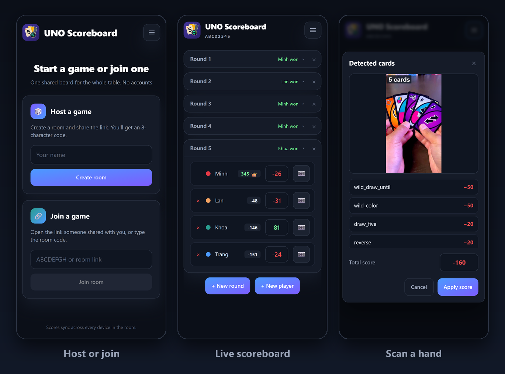

# UNO Flip Scoreboard

> **One live scoreboard for the whole table, with in-browser card scanning.**

[](https://react.dev)
[](https://www.typescriptlang.org/)
[](https://vite.dev/)
[](https://supabase.com/)
[](https://onnxruntime.ai/docs/tutorials/web/)



*Host or join · Live scoreboard · Card scan (phone layout)*

---

## Contents

- [Features](#features)
- [Scoring rules](#scoring-rules)
- [How it works](#how-it-works)
- [Repository layout](#repository-layout)
- [Quick start](#quick-start)
- [Scripts](#scripts)
- [Training the detector](#training-the-detector)
- [Deployment](#deployment)
- [Testing](#testing)
- [More docs](#more-docs)

## Features

UNO Flip is normally scored by hand: someone adds up the cards left in every
other player's hand, writes the number down, and repeats until someone reaches
500. This app replaces the pen and paper with a shared board that every phone at
the table can see and edit live, and it can score a hand from a photo.

- **No accounts.** Create a room with one tap and share an 8-character code or
  link. Each device claims a player anonymously.
- **Live sync.** Every edit lands in Postgres and is pushed to the other phones
  over Supabase Realtime.
- **Phone-first.** Thumb-sized controls and a single scrolling board, designed
  for a phone held at the table.
- **Scan a hand.** Point the camera at the cards left in a hand; a YOLOv8
  detector running in the browser names each card and sums the points.
- **One set of rules.** The board, the scanner, and the PNG export all derive
  totals and winners from the same scoring code.
- **Share the result.** Copy the room code or link, or export the whole
  scoreboard as a PNG from the header menu.
- **English and Vietnamese.** No i18n library: a typed dictionary where a
  missing translation is a compile error.

## Scoring rules

| Cards                                               | Points     |
| --------------------------------------------------- | ---------- |
| Number cards `0`-`9`                                | Face value |
| `Skip`, `Skip All`, `Reverse`, `Flip`, `Draw One`, `Draw Five` | 20         |
| `Wild`, `Wild Draw Two`, `Wild Draw Until`          | 50         |

A player with a blank score in a round is the round winner; they receive the
sum of everyone else's cards.

> Hand points are stored as **negative** numbers. The app forces the minus sign,
> and the scanner produces negative totals too. The winner's blank cell is
> rendered as the positive sum they earned.

UNO Flip games are usually played to 500; the board keeps the running totals so
the table can see who is closest. The rules live in
[`app/src/lib/unoScoring.ts`](app/src/lib/unoScoring.ts) and
[`app/src/lib/scoreboard.ts`](app/src/lib/scoreboard.ts).

## How it works

```text
┌──────────────┐        RPC (cmd_*)         ┌────────────────────┐
│  React app   │ ──────────────────────────▶ │ Supabase Postgres  │
│  (phone)     │ ◀────────────────────────── │ rooms / rounds /   │
│              │   Realtime `rooms.version`  │ scores / events    │
└──────┬───────┘                             └────────────────────┘
       │
       │  YOLOv8 → ONNX (NMS baked in)
       ▼
┌──────────────────────┐
│ onnxruntime-web WASM │  card boxes + class names → points
└──────────────────────┘
```

### Rooms and realtime

- Clients never write tables directly. Every mutation is one RPC
  (`cmd_add_round`, `cmd_set_score`, …) carrying `p_base_version` and
  `p_request_id`.
- Writes are serialized per room with a compare-and-swap on `rooms.version`.
  A stale version returns `PT409`; replaying the same `request_id` is free.
- Each room accepts 120 mutations per minute and 600 per hour. `create_room`
  and `join_room` are rate-limited per identity, so codes cannot be enumerated.
- Players are claimed by the device that joins as them. `peek_room` exposes
  only unclaimed names, and `join_room` rejects a name another device owns.
- Clients subscribe to `rooms.version` and refetch `get_room` on every bump, so
  a dropped realtime event only delays a refresh; it can never lose state.
- Score conflicts are retried once automatically when the conflicting change
  touched a different cell. If the same cell changed, the user sees a conflict.

The full schema and RPCs live in [`supabase/migrations/`](supabase/migrations).
The conflict policy is covered in [`app/README.md`](app/README.md).

### Card detection

1. The browser downloads the model once. Production gets a short-lived signed
   URL from [`app/api/model.ts`](app/api/model.ts), which signs a private Vercel
   Blob. Local development falls back to `app/public/model/`.
2. The image is letterboxed to 640×640 and run through
   [onnxruntime-web](https://onnxruntime.ai/docs/tutorials/web/). NMS is baked
   into the exported graph, so the output is already a flat list of
   `x1, y1, x2, y2, confidence, class`.
3. Detections are mapped back to the original image, deduplicated, converted to
   points, and shown for confirmation before the score is applied.

The 18 classes are color-agnostic and split across the light and dark sides, so
a `light_blue_7` and a `dark_blue_7` both score as `7`:

```text
wild_color, wild_draw_two, 1, 2, 3, 4, 5, 6, 7, 8, 9, flip, draw_one,
skip, reverse, wild_draw_until, draw_five, skip_all
```

## Repository layout

```text
uno-counter/
├─ app/                  React + Vite + Tailwind frontend and Vercel function
│  ├─ src/               pages, components, room API, scoring, i18n
│  ├─ api/model.ts       signs the private model blob URL
│  └─ public/            PWA icons and local model fallback
├─ supabase/migrations/  Postgres schema, RPCs, rate limits
├─ data/                 synthetic dataset generator (sprite → YOLO)
├─ train/                YOLOv8 fine-tuning and ONNX export
├─ test_images/          sample card photos
└─ docs/screenshots/     images used by this README
```

## Quick start

### Prerequisites

- Node.js 20.19+ (or 22.12+) and npm
- A Supabase project with anonymous sign-ins enabled
- The [Vercel CLI](https://vercel.com/docs/cli) if you want card scanning in
  development
- Python 3.10+ only if you plan to regenerate the dataset or retrain the model

### 1. Install

```bash
cd app
npm install
```

### 2. Configure the frontend

Create `app/.env` (or `.env.local`) with:

```dotenv
VITE_SUPABASE_URL=https://<project-ref>.supabase.co
VITE_SUPABASE_ANON_KEY=<anon-key>
```

For the model endpoint under `vercel dev`, also add:

```dotenv
BLOB_READ_WRITE_TOKEN=<vercel-blob-read-write-token>
```

`VITE_*` variables are the only ones Vite exposes to the browser. The
Supabase/Vercel integration may inject `SUPABASE_URL` and
`NEXT_PUBLIC_SUPABASE_ANON_KEY`, but the app does not read those names.

### 3. Apply the database schema

Run the migrations in order from [`supabase/migrations/`](supabase/migrations)
with the Supabase CLI:

```bash
supabase link --project-ref <project-ref>
supabase db push
```

Or paste them into the SQL editor in filename order.

Then open **Supabase → Authentication → Providers → Anonymous** and enable
anonymous sign-ins. Without it every RPC fails with `auth_required`.

### 4. Run it

```bash
npm run vercel:dev
```

Open <http://localhost:5173>. `vercel dev` serves the SPA and the
`/api/model` function from one origin, which is what scanning needs.

For UI work that does not scan cards, plain Vite is enough:

```bash
npm run dev
```

### 5. Try it

1. Enter a name and press **Create room**.
2. Open the room link on a second phone (or a private window) and join as
   another player.
3. Press **+ New round**, enter the points left in each player's hand (the app
   stores them as negative numbers), and leave the winner's cell blank.
4. Tap 📷 next to a player to score their hand from a photo.

## Scripts

Run these from `app/`:

| Command                 | What it does                                            |
| ----------------------- | ------------------------------------------------------- |
| `npm run dev`           | Vite dev server without serverless functions            |
| `npm run vercel:dev`    | Vite + `api/model.ts` on <http://localhost:5173>        |
| `npm run build`         | Production build into `dist/`                           |
| `npm run preview`       | Preview the production build                            |
| `npm run typecheck`     | `tsc --noEmit` over `src/`, `api/`, and configs         |
| `npm test`              | Vitest run (unit + component tests)                     |
| `npm run test:watch`    | Vitest in watch mode                                    |
| `npm run test:coverage` | Tests with V8 coverage                                  |
| `npm run format`        | Prettier, including Tailwind class sorting              |

## Training the detector

The detector is trained on synthetic hands, so the repository does not need a
photo dataset:

```bash
# 1. Slice the sprite sheets into per-card PNGs
cd data
python extract_cards.py flip_light_combine.png --side light
python extract_cards.py flip_dark_combine.png  --side dark

# 2. Composite fanned hands into YOLO images + labels
python compose_hands.py --count 8000 --full-card
python compose_hands.py --count 2000 --min-cards 1 --max-cards 1 --full-card --start-index 8000 --keep-existing

# 3. Fine-tune and export
cd ../train
python train.py --epochs 100 --batch 16 --workers 2 --export
```

After training, export with NMS baked in and serve the result:

```powershell
.\.venv\Scripts\python.exe -c "from ultralytics import YOLO; YOLO('train/runs/uno_flip-X/weights/best.pt').export(format='onnx', nms=True, imgsz=640)"
Copy-Item train\runs\uno_flip-X\weights\best.onnx app\public\model\uno-flip-detector.onnx -Force
```

For production, upload `best.onnx` to a **private** Vercel Blob named
`uno-flip-detector.onnx`; `api/model.ts` will sign it on request.

## Deployment

1. Import the repository into Vercel and set the project root to `app/`.
2. Add `VITE_SUPABASE_URL`, `VITE_SUPABASE_ANON_KEY`, and
   `BLOB_READ_WRITE_TOKEN` to every environment.
3. Push the Supabase migrations to the production project and enable anonymous
   sign-ins.
4. Upload the exported model to the private Blob store.
5. Deploy. `vercel.json` rewrites `/r/*` to the SPA, so room links work on a
   cold load.

Rooms and their rounds are stored in Postgres; no game state lives in the
browser, so reloading or switching devices never loses a scoreboard.

## Testing

The app has unit and component tests for the room API, scoring, scoreboard
derivation, PNG export, room code parsing, the menu, and both pages:

```bash
cd app
npm test
npm run typecheck
```

Tests run on Vitest with `jsdom`; `setupTests.ts` loads jest-dom matchers.

## More docs

- [Frontend notes, room backend, styling, and i18n](app/README.md)
- [Synthetic dataset pipeline](data/README.md)
- [Model training and export](train/README.md)
